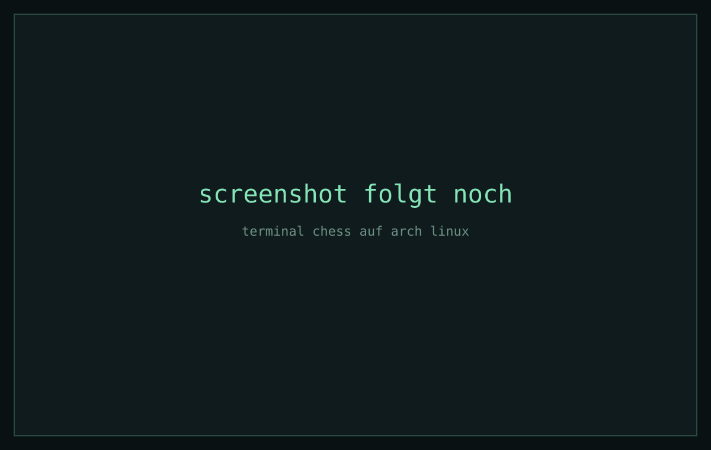

# terminal chess

ein kleines schachspiel mit einem retro brett und steuerung über das terminal. ich wollte ein projekt bauen das sich wie ein altes pc spiel anfühlt und trotzdem ganz normales schach spielt. die züge kommen aus dem terminal. das fenster zeigt denselben spielstand direkt an.

das ist mein neues C++ projekt und noch in arbeit. ich lerne dabei mehr über C++ und Linux.



## was es kann

- züge per SAN oder UCI eingeben.
- schach. matt und patt erkennen.
- rochade. en passant und umwandlung spielen.
- züge zurücknehmen oder eine neue partie starten.
- dreifache stellungswiederholung und die 50 züge regel beanspruchen.
- fünffache stellungswiederholung und die 75 züge regel automatisch werten.
- unzureichendes material als remis erkennen.
- zugverlauf. letzte züge und geschlagene figuren anzeigen.
- den gleichen spielstand im terminal und im fenster verwenden.

## voraussetzungen

das projekt ist für Arch Linux gedacht. zum bauen brauchst du einen compiler mit C++20. außerdem brauchst du CMake und SDL2. die schachregeln kommen aus einer mitgelieferten header only bibliothek.

```sh
sudo pacman -S --needed base-devel cmake sdl2
```

## starten

im projektordner baut das skript das spiel und startet es.

```sh
./run.sh
```

beim ersten start wird der ordner `build` angelegt. für ein spiel nur im terminal kannst du das fenster abschalten.

```sh
./run.sh --terminal-only
```

du kannst das projekt auch selbst bauen.

```sh
cmake -S . -B build -DCMAKE_BUILD_TYPE=Release
cmake --build build --parallel
./build/terminal-chess
```

## spielen

gib einen zug in das terminal ein. beide schreibweisen gehen.

```text
e3
Nf3
O-O
e2e4
```

die figurenbuchstaben in SAN bleiben groß. befehle sind klein geschrieben.

| befehl | macht |
| --- | --- |
| `help` | zeigt die befehle und zugformate. |
| `board` | zeigt das brett im terminal. |
| `moves` oder `history` | zeigt den zugverlauf. |
| `undo` | nimmt den letzten zug zurück. |
| `restart` | startet eine neue partie. |
| `fen` | zeigt die aktuelle stellung. |
| `status` | zeigt wer am zug ist und den spielstand. |
| `claim` | beansprucht ein mögliches remis. |
| `claim <zug>` | prüft einen angekündigten zug für die 50 züge regel oder wiederholung. |
| `quit` | beendet das spiel. |

## bauen und testen

baue das projekt mit CMake. die tests prüfen die wichtigsten regeln und die verbindung zwischen terminal und GUI ansicht.

```sh
cmake -S . -B build -DCMAKE_BUILD_TYPE=Release
cmake --build build --parallel
ctest --test-dir build --output-on-failure
```

## aufbau

`src/game.cpp` verwaltet die stellung und die remisregeln. `src/commands.cpp` verarbeitet terminaleingaben. `src/gui.cpp` zeichnet die ansicht des zentralen spielstands. die schachregeln bleiben an einer stelle.

die legalen züge und die notation kommen aus [chess-library](https://github.com/Disservin/chess-library). das brettfenster verwendet SDL2. die schachbibliothek und ihre lizenz liegen unter `third_party/chess-library`.

## lizenz

das projekt steht unter der MIT lizenz. die mitgelieferte schachbibliothek hat ihre eigene MIT lizenz.

ein teil der textformulierung in dieser dokumentation wurde mit ki unterstützung erstellt.
